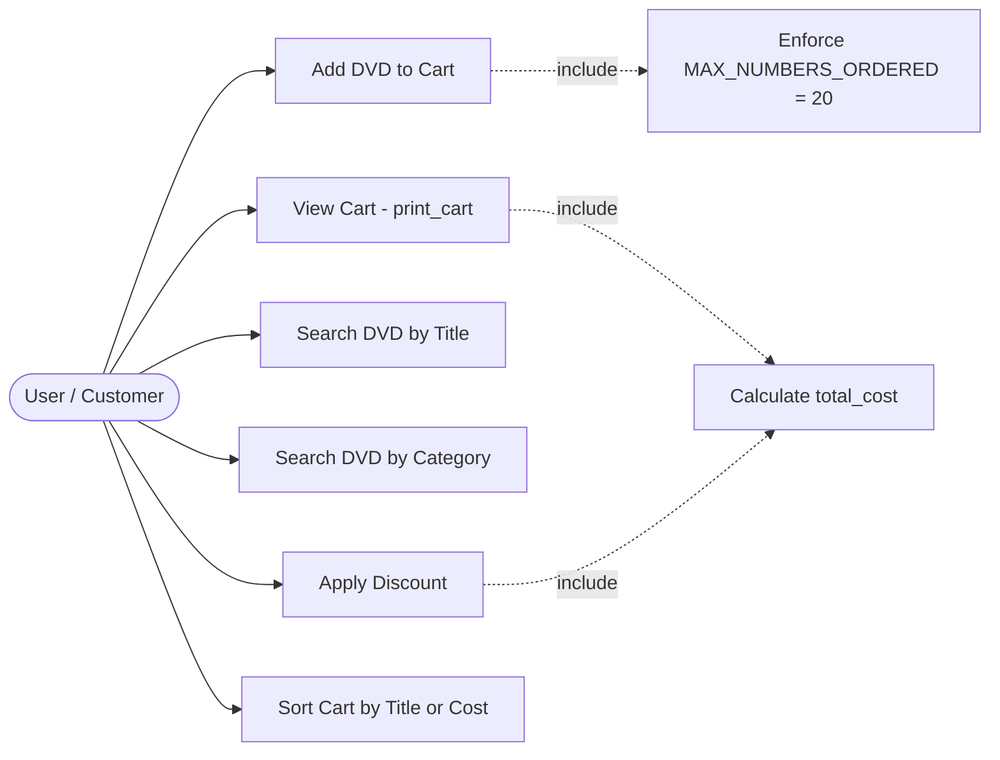

# AIMS-mini Use Case Diagram & Specification

## 1. Actors
- **User / Customer:** Thêm đĩa vào giỏ hàng, xem giỏ hàng, tìm kiếm DVD theo tiêu đề/thể loại, áp dụng mã giảm giá, sắp xếp các đĩa trong giỏ.
- **System (AIMS):** Quản lý giới hạn giỏ hàng (`MAX_NUMBERS_ORDERED = 20`), tính toán tổng chi phí và chiết khấu, lọc và trả về kết quả tìm kiếm/sắp xếp.

---

## 2. Use Case Diagram

---

## 3. Use Case Specification

| ID | Tên Use Case | Tác nhân | Mô tả tóm tắt | Luồng chính (Main Flow) | Luồng ngoại lệ / Mở rộng (Alternative Flow) |
| :---: | :--- | :--- | :--- | :--- | :--- |
| **UC1** | Add DVD to Cart | User | Thêm một đĩa DVD vào danh sách giỏ hàng | 1. Người dùng chọn DVD cần thêm. 2. Hệ thống kiểm tra số lượng hiện tại (`< 20`). 3. Thêm DVD vào danh sách `items`. 4. In thông báo xác nhận thành công. | **Giỏ đầy (>= 20 đĩa):** Hệ thống từ chối thêm, in thông báo `"The cart is almost full"`. |
| **UC2** | View Cart | User | Hiển thị toàn bộ đĩa đã đặt và tổng chi phí | 1. Người dùng gọi hàm `print_cart()`. 2. Hệ thống lặp qua danh sách đĩa, hiển thị chi tiết (STT, tên, thể loại, đạo diễn, độ dài, giá). 3. Tính và in ra tổng chi phí (`Total cost`). | **Giỏ trống:** Nếu giỏ hàng không có đĩa nào, hệ thống in thông báo `"The cart is empty"`. |
| **UC3** | Search DVD by Title | User | Tìm kiếm đĩa theo từ khóa tiêu đề | 1. Người dùng cung cấp từ khóa `title`. 2. Hệ thống chuyển đổi không phân biệt chữ hoa/thường (`lower()`). 3. Trả về danh sách đĩa có tiêu đề chứa từ khóa. | **Không tìm thấy:** Nếu không có đĩa nào khớp hoặc từ khóa rỗng, hệ thống trả về danh sách rỗng `[]`. |
| **UC4** | Search DVD by Category | User | Tìm kiếm đĩa theo thể loại | 1. Người dùng cung cấp tên thể loại `category`. 2. Hệ thống lọc danh sách đĩa khớp với thể loại. 3. Trả về danh sách kết quả phù hợp. | **Thể loại không tồn tại:** Trả về danh sách rỗng `[]`. |
| **UC5** | Apply Discount | User | Tính tổng tiền sau khi áp dụng mã giảm giá | 1. Người dùng truyền tỷ lệ giảm giá (`percent`). 2. Hệ thống kiểm tra giá trị phần trăm hợp lệ (`0 <= percent <= 100`). 3. Tính toán và trả về tổng tiền sau khi chiết khấu. | **Phần trăm không hợp lệ (`< 0` hoặc `> 100`):** Hệ thống ném ngoại lệ `ValueError("Discount percentage must be between 0 and 100")`. |
| **UC6** | Sort Cart | User | Sắp xếp các đĩa trong giỏ hàng | 1. Người dùng chọn tiêu chí sắp xếp: theo tiêu đề (`sort_by_title`) hoặc theo giá (`sort_by_cost`). 2. Hệ thống sắp xếp trực tiếp danh sách `items`. | **Giỏ trống hoặc có 1 đĩa:** Danh sách giữ nguyên không thay đổi. |
